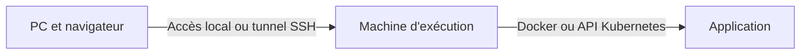

# Adapter le projet à votre environnement

Ce projet déploie une application ; il n'impose pas d'hyperviseur. Vous pouvez utiliser votre poste, une VM Vagrant, une VM Proxmox, VMware/VirtualBox, un serveur physique ou un cluster Kubernetes existant.

## 1. Distinguer les machines

- **Poste de travail** : ordinateur sur lequel vous ouvrez le navigateur.
- **Machine d'exécution** : ordinateur ou VM sur lequel vous lancez Docker, ou kubectl et Helm.
- **Nœuds Kubernetes** : machines qui exécutent les Pods ; elles peuvent être différentes de la machine d'exécution.

`localhost` désigne toujours la machine où une commande ou un navigateur s'exécute. L'adresse `localhost` d'une VM ne désigne pas votre PC.



## 2. Choisir un chemin

| Environnement déjà disponible | Chemin à suivre |
|---|---|
| PC Linux, macOS ou Windows avec Docker | Lab 01 directement ; kind facultatif pour les labs Kubernetes |
| VM Linux dans Proxmox, Vagrant ou autre | Exécuter les commandes dans la VM ; utiliser le tunnel SSH de l'étape 4 |
| Cluster K3s, kubeadm, Minikube ou autre | Conserver votre cluster ; vérifier kubeconfig, stockage et disponibilité des images |
| Aucun cluster | Créer un cluster kind comme proposé à l'étape 6 ; Proxmox n'est pas nécessaire |
| CI GitHub seulement, lab 04 | Les jobs s'exécutent sur les runners GitHub ; aucune VM personnelle requise |

Les blocs de commandes utilisent Bash ou un shell compatible. Sous Windows, utiliser WSL2 ou une VM Linux pour ces commandes ; le navigateur peut rester sous Windows. Sur Linux, installer Docker Engine et son plugin Compose selon votre distribution ; sur macOS/Windows, utiliser un environnement Docker compatible.

Références d'installation : [Docker Engine](https://docs.docker.com/engine/install/), [kind](https://kind.sigs.k8s.io/docs/user/quick-start/), [kubectl](https://kubernetes.io/docs/tasks/tools/) et [Helm](https://helm.sh/docs/intro/install/). Pour un cluster K3s, vérifier aussi ses [prérequis propres](https://docs.k3s.io/installation/requirements).

## 3. Préparer la machine d'exécution

Décompresser ou cloner **ce projet** sur la machine où les commandes seront lancées. Se placer dans son dossier contenant `README.md`, `GUIDE.md`, `apps/` et `labs/`, puis vérifier :

```bash
pwd
ls apps labs
openssl version
python3 --version
```

Python 3 sert aux scripts de préparation et de validation. OpenSSL génère les secrets de démonstration. Les builds nécessitent de l'accès réseau à npm et aux registres d'images. La présence de Docker sur votre PC n'implique pas sa présence dans votre VM.

À titre de point de départ, prévoir 2 vCPU, 4 Go de RAM et 20 Go libres pour Docker ou un petit cluster local ; prévoir davantage pour ArgoCD, Grafana et Vault exécutés ensemble. Ces tailles sont des estimations pédagogiques à adapter à votre distribution et aux services déjà présents, pas des minima garantis.

## 4. Accéder à une application exécutée dans une VM

Les fichiers fournis écoutent sur la boucle locale pour les accès de démonstration. Conserver cette configuration et établir un tunnel SSH depuis le PC :

```bash
ssh -N -L 8080:127.0.0.1:8080 utilisateur@ADRESSE_DE_VOTRE_VM
```

Remplacer l'utilisateur et l'adresse par ceux de votre VM. Ouvrir ensuite `http://localhost:8080` **sur le PC**. Dans la VM, Docker Compose doit déjà servir ce port, ou `kubectl port-forward service/frontend 8080:80` doit être actif.

Si le port 8080 est occupé sur le PC :

```bash
ssh -N -L 18080:127.0.0.1:8080 utilisateur@ADRESSE_DE_VOTRE_VM
```

Ouvrir alors `http://localhost:18080`. L'API reste accessible par `/api` à travers Nginx ; aucune URL interne de VM ne doit être ajoutée au frontend.

Pour une VM gérée par Vagrant, depuis le dossier de son Vagrantfile sur le PC :

```bash
vagrant ssh-config > vagrant-ssh.local.conf
ssh -F vagrant-ssh.local.conf -N -L 8080:127.0.0.1:8080 default
```

Remplacer `default` par le nom de machine indiqué dans `vagrant ssh-config` si votre Vagrantfile en définit plusieurs. Cette méthode réutilise le port SSH et la clé du provider. Ne publiez pas le fichier local généré.

Une simple redirection Vagrant guest:8080 vers host:8080 ne suffit pas nécessairement lorsque le service est lié à `127.0.0.1` dans la VM. Le tunnel ci-dessus évite de changer son adresse d'écoute. Voir les [ports redirigés Vagrant](https://developer.hashicorp.com/vagrant/docs/networking/forwarded_ports).

## 5. Accéder à Kubernetes depuis votre poste ou votre VM

Utiliser le kubeconfig fourni par votre propre cluster. La copie et la configuration de ce fichier dépendent de votre distribution. Vérifier avant tout déploiement :

```bash
kubectl config get-contexts
kubectl config current-context
kubectl cluster-info
kubectl get nodes -o wide
kubectl get storageclass
```

Tous les nœuds utilisés doivent être Ready. Il faut disposer des droits de création des ressources du cours ; le lab 07 nécessite également l'installation de CRD si ESO n'est pas déjà présent.

Si plusieurs clusters sont configurés, choisir explicitement le vôtre avec `kubectl config use-context NOM_DE_VOTRE_CONTEXTE`. Ne choisir `kind-stock-labs` que si vous avez effectivement créé ce cluster kind.

Le `port-forward` écoute par défaut sur la machine qui exécute kubectl. Si kubectl est exécuté sur votre PC, ouvrez directement localhost dans votre navigateur. S'il est exécuté dans une VM, ajoutez le tunnel de l'étape 4. Le Service ClusterIP reste interne au cluster. Voir [le port-forward Kubernetes](https://kubernetes.io/docs/tasks/access-application-cluster/port-forward-access-application-cluster/).

## 6. Créer un cluster uniquement si vous n'en avez pas

Pour les projets 02, 03, 05, 06 et 07, avec Docker et kind sur la machine d'exécution :

```bash
kind create cluster --name stock-labs --config labs/dsk-stock-lab02-kubernetes/kind.yaml
kubectl config use-context kind-stock-labs
```

Cette étape est facultative si vous avez déjà un cluster opérationnel. Le fichier kind est inclus dans les projets concernés. Le lab 04 n'a pas besoin d'un cluster pour sa CI.

## 7. Préparer les images pour votre cluster

Les images construites avec Docker sur une machine ne sont pas automatiquement disponibles dans Kubernetes. Même si Docker et K3s sont sur la même VM, leurs magasins d'images peuvent être distincts.

Construire depuis la racine du projet sur une machine de même architecture que les nœuds ciblés :

```bash
docker build -t dsk-stock-backend:lab -f labs/dsk-stock-lab01-docker/backend.Dockerfile .
docker build -t dsk-stock-frontend:lab -f labs/dsk-stock-lab01-docker/frontend.Dockerfile .
```

**Chemin A — kind sur la même machine** :

```bash
kind load docker-image dsk-stock-backend:lab dsk-stock-frontend:lab --name stock-labs
```

**Chemin B — votre cluster existant, via un registre accessible à ses nœuds** :

```bash
export LAB_REGISTRY=docker.io/REMPLACER_PAR_VOTRE_COMPTE
export LAB_TAG=lab-v1
export LAB_BACKEND_IMAGE="$LAB_REGISTRY/dsk-stock-backend:$LAB_TAG"
export LAB_FRONTEND_IMAGE="$LAB_REGISTRY/dsk-stock-frontend:$LAB_TAG"
docker login docker.io
docker tag dsk-stock-backend:lab "$LAB_BACKEND_IMAGE"
docker tag dsk-stock-frontend:lab "$LAB_FRONTEND_IMAGE"
docker push "$LAB_BACKEND_IMAGE"
docker push "$LAB_FRONTEND_IMAGE"
```

Remplacer le compte avant exécution, puis rendre ces images de démonstration publiques, ou utiliser votre propre registre et sa configuration d'accès. Les guides de base supposent des pulls sans identifiants. Un registre privé demande une configuration `imagePullSecrets` sur tous les Pods concernés, y compris les migrations : elle n'est pas fournie dans ce parcours.

Vérifier l'architecture des nœuds :

```bash
kubectl get nodes -o custom-columns=NAME:.metadata.name,ARCH:.status.nodeInfo.architecture
```

Une image ARM64 construite sur un Mac ARM ne suffit pas pour des nœuds AMD64. Construire sur une machine de l'architecture cible ou utiliser le build multiarchitecture du lab 04.

**Variante K3s sans registre** : exporter les images, transférer l'archive sur chacun des nœuds concernés, puis l'importer dans le runtime K3s :

```bash
docker save -o /tmp/dsk-stock-images.tar dsk-stock-backend:lab dsk-stock-frontend:lab
```

Sur chaque nœud K3s où l'archive a été copiée :

```bash
sudo k3s ctr images import /tmp/dsk-stock-images.tar
```

Conserver les noms `dsk-stock-backend:lab` et `dsk-stock-frontend:lab` dans cette variante. Ce mécanisme concerne K3s ; pour une autre distribution, utiliser son mécanisme d'import ou le registre. Référence : [import d'images K3s](https://docs.k3s.io/installation/airgap).

## 8. Choisir le stockage

Le lab Docker utilise un volume Docker. Les projets Kubernetes utilisent un PVC PostgreSQL : l'hyperviseur n'installe pas automatiquement le provisionneur de stockage Kubernetes.

- Si votre cluster a une StorageClass par défaut fonctionnelle, conserver les valeurs fournies.
- Si vous voulez une autre classe existante, choisir son nom avec `kubectl get storageclass`, puis appliquer le paramètre décrit dans GUIDE.md.
- Si aucune classe ne peut provisionner de volume, installer/configurer le stockage selon votre distribution ou préparer un PV correspondant au PVC avant de continuer.

Choisir la classe avant la première installation. Changer de classe sur un volume déjà créé demande une migration de données ou une nouvelle installation dans un namespace distinct ; un simple upgrade ne déplace pas les données.

Le nom de classe dépend de votre cluster : ne copiez pas `longhorn`, `local-path` ou `standard` sans vérifier leur présence. Lorsqu'une classe utilise WaitForFirstConsumer, le PVC peut attendre la création du Pod consommateur avant son attribution. Voir les [StorageClasses Kubernetes](https://kubernetes.io/docs/concepts/storage/storage-classes/).

## 9. Ports à ouvrir dans le navigateur

| Composant | Port local habituel | Projet |
|---|---|---|
| Application | 8080 | 01, 02, 03, 05, 06, 07 |
| Swagger/API, facultatif | 3001 | 01 ou port-forward backend |
| ArgoCD | 8443, HTTPS | 05 |
| Prometheus | 9090 | 06 |
| Grafana | 3000 | 06 |

Dans une VM, adapter le tunnel SSH : par exemple `ssh -N -L 9090:127.0.0.1:9090 -L 3000:127.0.0.1:3000 utilisateur@ADRESSE_DE_VOTRE_VM` pour les deux outils d'observabilité. Aucun DNS privé ni certificat wildcard DSK n'est nécessaire.

## 10. Revenir au guide du projet

Vous devez maintenant connaître votre machine d'exécution, votre contexte Kubernetes éventuel, vos références d'images, votre stockage et votre méthode d'accès. Reprendre [GUIDE.md](GUIDE.md) à l'étape indiquée pour votre environnement.
