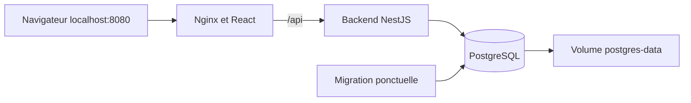

# Projet 01 — Déployer DSK Stock avec Docker Compose — Guide pas à pas

## Avant de commencer : choisissez votre environnement

Ce guide s'exécute depuis la racine **de ce projet**, où se trouvent `apps/` et `labs/`. Proxmox n'est pas requis : une VM Vagrant, une autre VM Linux, un poste personnel ou un cluster déjà disponible peuvent être utilisés.

1. Lire [ENVIRONNEMENT.md](ENVIRONNEMENT.md) pour distinguer PC, VM et cluster.
2. Préparer les outils demandés ci-dessous sur la machine d'exécution.
3. Si Kubernetes est utilisé, choisir soit le chemin kind, soit votre cluster existant ; préparer ses images et son stockage.
4. Choisir l'accès navigateur direct ou le tunnel SSH. Les URL localhost du pas à pas désignent la machine d'exécution ; le tunnel les rend disponibles depuis le PC.
5. Exécuter les étapes dans l'ordre et vérifier les résultats avant de continuer.

Les fichiers inclus suffisent pour ce projet ; il n'est pas nécessaire de cloner un autre dépôt de lab. Les liens vers d'autres projets expliquent les composants réutilisés et restent dans ce dépôt.

### Chemin poste ou VM

Sur votre poste : lancer Docker puis suivre le pas à pas. Dans une VM : installer Docker et Compose dans cette VM, y copier le projet, puis suivre les mêmes commandes. Pour afficher l'application sur le PC, ouvrir le tunnel SSH décrit dans ENVIRONNEMENT.md. PostgreSQL reste dans Docker ; aucune installation de base sur l'hôte n'est nécessaire.

## Mission et objectifs
Déployer une application complète sur votre ordinateur avec une seule commande, puis vérifier que les données persistent. Apprendre image/conteneur, réseau Compose, volume, healthcheck et migration.

Niveau : débutant Docker. Durée indicative : 1 à 2 h. Prérequis : Docker démarré, Compose v2, Git et accès aux registres npm et Docker Hub. Aucun Node ou PostgreSQL à installer sur l'hôte.

## Architecture


Le navigateur utilise `/api` sur le même serveur que l'interface. Nginx relaie ces requêtes vers `backend:3001`, nom résolu à l'intérieur du réseau Docker. Le navigateur ne peut pas résoudre ce nom Docker.

## Fichiers
- `compose.yaml` : services, ports et ordre de démarrage.
- `backend.Dockerfile`, `frontend.Dockerfile` : images dédiées aux labs.
- `nginx.conf` : fichiers React et proxy de l'API.
- `.env.example` : paramètres locaux.

Les images de labs remplacent les Dockerfiles historiques sans les supprimer. Le backend conserve les dépendances de compilation dans son image finale pour faciliter le cours ; l'optimisation constitue un exercice. Node 22 et pnpm 8.15.5 sont utilisés ; le verrou des dépendances est respecté.

## 1. Vérifier les outils
Depuis la racine :
```bash
docker version
docker compose version
```

## 2. Préparer la configuration
```bash
cp labs/dsk-stock-lab01-docker/.env.example labs/dsk-stock-lab01-docker/.env
openssl rand -hex 32
```
Copier la valeur générée dans `JWT_SECRET` du fichier `.env`. Les identifiants PostgreSQL fournis sont réservés à cette démonstration locale. Si vous les changez, utiliser ici des caractères alphanumériques et des underscores : la construction simplifiée de l'URL ne réalise pas l'encodage des caractères spéciaux.

## 3. Construire et démarrer
```bash
docker compose --env-file labs/dsk-stock-lab01-docker/.env -f labs/dsk-stock-lab01-docker/compose.yaml config --quiet
docker compose --env-file labs/dsk-stock-lab01-docker/.env -f labs/dsk-stock-lab01-docker/compose.yaml up -d --build
docker compose --env-file labs/dsk-stock-lab01-docker/.env -f labs/dsk-stock-lab01-docker/compose.yaml ps -a
```

PostgreSQL doit être sain avant la migration. Le service `migrate` se termine avec le code 0 ; ce n'est pas une panne. L'API démarre après ce succès, puis Nginx après la disponibilité de l'API. Ces dépendances sont décrites dans la [documentation Compose](https://docs.docker.com/compose/how-tos/startup-order/).

## 4. Vérifier
```bash
curl --fail http://localhost:3001/health
curl --fail http://localhost:8080/
docker compose --env-file labs/dsk-stock-lab01-docker/.env -f labs/dsk-stock-lab01-docker/compose.yaml logs migrate backend
```
Ouvrir http://localhost:8080, puis exécuter [le scénario métier](../SCENARIO.md). Swagger est accessible sur http://localhost:3001/docs.

## 5. Tester la persistance
```bash
docker compose --env-file labs/dsk-stock-lab01-docker/.env -f labs/dsk-stock-lab01-docker/compose.yaml down
docker compose --env-file labs/dsk-stock-lab01-docker/.env -f labs/dsk-stock-lab01-docker/compose.yaml up -d
```
Le produit doit être présent après reconnexion. Le volume est conservé par `down`.

## Exercices
1. Passer le port frontend de 8080 à 8081 sans reconstruire les images. Expliquer port hôte et port conteneur.
2. Expliquer pourquoi PostgreSQL ne publie aucun port sur l'hôte.
3. Supprimer le conteneur backend puis le recréer : les données doivent rester présentes.
4. Proposer une image backend plus petite qui garde Prisma pour la migration.
5. Comparer le healthcheck actuel avec une vérification de disponibilité de PostgreSQL.

Livrable : schéma réseau, commandes utilisées et preuve de persistance. Réussite : migration à 0, services disponibles, scénario métier réussi.

## Dépannage
- Port occupé : modifier `FRONTEND_PORT` ou `API_PORT` dans `.env`.
- Migration en échec : lire ses logs ; vérifier PostgreSQL et les identifiants.
- Mot de passe changé après initialisation : les variables ne modifient pas le compte PostgreSQL déjà créé dans le volume. Restaurer les anciens identifiants ou réinitialiser uniquement les données de lab.
- Échec de build : vérifier l'accès npm/Docker Hub et conserver `--frozen-lockfile` pour détecter un verrou incohérent.

## Nettoyage
Arrêter sans perdre les données :
```bash
docker compose --env-file labs/dsk-stock-lab01-docker/.env -f labs/dsk-stock-lab01-docker/compose.yaml down
```
Pour supprimer également la base de ce lab, utiliser la même commande avec `--volumes`. Cette variante détruit les données.

## Vérifier l'accès depuis votre propre poste

Si les commandes sont exécutées dans une VM, garder le tunnel SSH actif pendant la vérification. Ouvrir l'URL locale du tunnel, et non le nom interne `backend` ou `postgres`. Réaliser [le scénario métier](../SCENARIO.md) lorsqu'une application est déployée. Pour le lab CI, les critères portent d'abord sur le run GitHub et les images publiées.

Consigner votre environnement, la distribution Kubernetes éventuelle, les versions, l'architecture des nœuds et le résultat des étapes dans votre compte rendu. Les variantes Proxmox/Vagrant et les clusters existants sont documentés ; ils n'ont pas tous été exécutés lors de la validation initiale. Voir [les vérifications](../VALIDATION.md).
