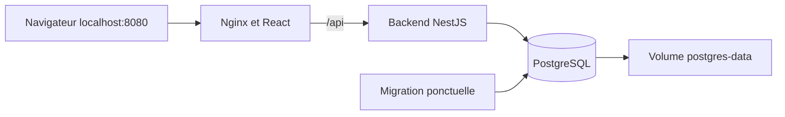

# Lab 01 — Mettre en service une application avec Docker Compose

## Votre mission

Vous rejoignez une petite équipe qui suit son matériel informatique dans des fichiers partagés. Elle vous remet DSK Stock et vous demande une première installation utilisable sur une machine de votre lab. Vous devez livrer l’interface, son API et PostgreSQL, puis montrer que les données survivent à la recréation des conteneurs.

**Niveau :** Débutant. **Durée indicative :** 1 à 2 heures, hors installation de votre infrastructure et téléchargement des images.

Vous travaillez sur **votre propre infrastructure**. Ce cours n’attribue ni VM, ni IP, ni cluster : vous réutilisez les vôtres. Le choix de Proxmox, Vagrant, d’un autre hyperviseur ou d’un poste local vous appartient. Le [guide d’environnement](ENVIRONNEMENT.md) explique les différences de réseau et d’accès.

**Ce que ce lab ajoute :** Conteneurs, réseau Compose, proxy Nginx, volume PostgreSQL et migration ponctuelle.

## 1. Vérifier vos prérequis

### Connaissances

Savoir ouvrir un terminal, naviguer dans des dossiers et identifier un port réseau. Une première lecture de Docker est utile ; connaître React ou NestJS n’est pas nécessaire.

### Infrastructure à fournir

Une machine Linux, une VM Linux Vagrant/Proxmox/VMware/VirtualBox ou un poste disposant de Docker. Point de départ indicatif : 2 vCPU, 4 Go de RAM et 20 Go disponibles pour les images et les volumes. Aucun cluster Kubernetes requis.

Les ressources indiquées sont des estimations pour un lab pédagogique, pas une garantie de dimensionnement. Vérifiez les ressources déjà consommées par vos services.

### Outils et résultat attendu

| Prérequis | Commande ou contrôle | Vous pouvez continuer si… |
|---|---|---|
| Docker Engine ou environnement Docker compatible | docker version | Le client peut communiquer avec le serveur Docker. |
| Docker Compose v2 ou compatible | docker compose version | La commande compose est disponible. |
| Python 3, OpenSSL et curl | python3 --version ; openssl version ; curl --version | Les outils de validation, de génération de secrets et de vérification HTTP sont présents. |

Git est nécessaire pour le clone ; il est facultatif pour lire et exécuter un ZIP hors exercices Git. Python 3 est requis pour les scripts fournis si vous les utilisez. Les commandes utilisent Bash ou un shell compatible : sous Windows, utilisez WSL2 ou votre VM Linux.

Les conteneurs embarquent Node et les dépendances de l’application : aucune installation manuelle de React, NestJS ou PostgreSQL sur votre hôte n’est demandée. Le lab CI installe ses outils dans les runners.

Ne poursuivez pas si un prérequis indispensable échoue : utilisez les liens d’installation d’ENVIRONNEMENT.md et les diagnostics du guide. Installer un outil sur votre PC ne l’installe pas dans votre VM.

## 2. Récupérer les sources chez vous

Le dépôt du parcours est `https://github.com/sdiawa/lab-devops.git`. Il doit contenir les sept dossiers nommés `dsk-stock-lab01-docker` à `dsk-stock-lab07-vault-eso`. Les noms de dossier sont significatifs pour les commandes, la CI et ArgoCD.

### Méthode A — Cloner avec Git

Sur la machine d’exécution choisie :

```bash
mkdir -p "$HOME/devops-labs"
cd "$HOME/devops-labs"
git clone https://github.com/sdiawa/lab-devops.git
cd lab-devops
git rev-parse --short HEAD
```

Notez la révision affichée dans votre compte rendu. Si vous avez déjà récupéré le dépôt pour un autre lab, réutilisez ce dossier ; sauvegardez vos modifications locales avant toute mise à jour. N’exécutez pas de reset pour simplement changer de lab.

Vous êtes maintenant à la racine Git du parcours. Entrez dans le projet :

```bash
cd dsk-stock-lab01-docker
ls
```

Résultat attendu : vous voyez `README.md`, `SCENARIO.md`, `GUIDE.md`, `ENVIRONNEMENT.md`, `apps/`, `labs/` et `package.json`. **Toutes les commandes de déploiement qui suivent partent de ce dossier**, sauf lorsqu’un retour à la racine Git est explicitement indiqué.

### Méthode B — Télécharger une archive ZIP

1. Ouvrez le dépôt dans votre navigateur.
2. Sélectionnez la branche ou la révision indiquée sur la page du cours.
3. Cliquez sur **Code**, puis **Download ZIP**.
4. Décompressez l’archive ; GitHub ajoute généralement le nom de branche au dossier extrait, par exemple `lab-devops-main`.
5. Ouvrez un terminal dans le sous-dossier `dsk-stock-lab01-docker` de cette archive.
6. Vérifiez la présence de `apps/` et `labs/` avant d’exécuter une commande.

Le ZIP est une copie des sources sans historique Git. Pour les labs 04 et 05, utilisez le fork et le clone pour réaliser les exercices de commits et de livraison. Le ZIP convient pour lire ces cours ; à lui seul, il ne crée pas un dépôt dans lequel vous pouvez pousser.

### Si l’exécution se fait dans une VM

Clonez directement dans la VM après connexion SSH, ou transférez le dépôt complet. Exemple depuis votre PC, avant d’entrer dans le sous-dossier du lab :

```bash
scp -r lab-devops utilisateur@ADRESSE_DE_VOTRE_VM:~/
ssh utilisateur@ADRESSE_DE_VOTRE_VM
```

Dans la VM, entrez dans `~/lab-devops/dsk-stock-lab01-docker`. Adaptez l’utilisateur, l’adresse et le port SSH à votre infrastructure. Pour Vagrant, vous pouvez utiliser le dossier partagé de votre configuration ou les informations de `vagrant ssh-config`. Les clés et les IP ne sont pas fournies par ce dépôt.

Références : [cloner un dépôt GitHub](https://docs.github.com/en/repositories/creating-and-managing-repositories/cloning-a-repository) et [télécharger ses sources](https://docs.github.com/en/repositories/working-with-files/using-files/downloading-source-code-archives).

## 3. Préparer les paramètres de votre infrastructure

Choisissez la machine qui exécutera Docker. Si c’est une VM, notez son accès SSH ; le navigateur peut rester sur votre ordinateur. Vérifiez que les ports locaux 8080 et 3001 sont libres, ou choisissez les autres ports dans le fichier `.env`.

Avant les commandes techniques, complétez ce tableau dans votre [compte rendu](COMPTE-RENDU.md) :

| Paramètre | Votre valeur |
|---|---|
| Machine qui exécutera les commandes | PC, VM ou serveur choisi |
| Accès au navigateur | Local ou tunnel SSH |
| Contexte Kubernetes, si utilisé | Nom relevé avec kubectl |
| Référence des images, si Kubernetes | Registre/tag ou import dans le runtime |
| Stockage, si Kubernetes | StorageClass ou PV préparé |
| Révision des sources | Commit Git ou archive utilisée |

Pour Kubernetes, une image construite dans Docker n’est pas forcément présente dans le runtime du cluster. Avant le déploiement, suivez l’étape 7 d’ENVIRONNEMENT.md : registre accessible aux nœuds, import K3s adapté ou chargement kind. Pour les labs 01 et 04, ce point n’impose pas de créer un cluster.

## 4. Réaliser le lab pas à pas

Les fichiers sont déjà fournis dans ce dossier. Lisez chaque action, exécutez ses commandes sur la machine choisie et vérifiez le résultat avant de passer à la suivante. Les fichiers locaux contenant vos paramètres ou vos secrets restent hors de Git.

### Architecture


Le navigateur utilise `/api` sur le même serveur que l'interface. Nginx relaie ces requêtes vers `backend:3001`, nom résolu à l'intérieur du réseau Docker. Le navigateur ne peut pas résoudre ce nom Docker.

### Fichiers
- `compose.yaml` : services, ports et ordre de démarrage.
- `backend.Dockerfile`, `frontend.Dockerfile` : images dédiées aux labs.
- `nginx.conf` : fichiers React et proxy de l'API.
- `.env.example` : paramètres locaux.

Les images de labs remplacent les Dockerfiles historiques sans les supprimer. Le backend conserve les dépendances de compilation dans son image finale pour faciliter le cours ; l'optimisation constitue un exercice. Node 22 et pnpm 8.15.5 sont utilisés ; le verrou des dépendances est respecté.

### Action 1 — Vérifier les outils
Depuis la racine :
```bash
docker version
docker compose version
```

### Action 2 — Préparer la configuration
```bash
cp labs/dsk-stock-lab01-docker/.env.example labs/dsk-stock-lab01-docker/.env
openssl rand -hex 32
```
Copier la valeur générée dans `JWT_SECRET` du fichier `.env`. Les identifiants PostgreSQL fournis sont réservés à cette démonstration locale. Si vous les changez, utiliser ici des caractères alphanumériques et des underscores : la construction simplifiée de l'URL ne réalise pas l'encodage des caractères spéciaux.

### Action 3 — Construire et démarrer
```bash
docker compose --env-file labs/dsk-stock-lab01-docker/.env -f labs/dsk-stock-lab01-docker/compose.yaml config --quiet
docker compose --env-file labs/dsk-stock-lab01-docker/.env -f labs/dsk-stock-lab01-docker/compose.yaml up -d --build
docker compose --env-file labs/dsk-stock-lab01-docker/.env -f labs/dsk-stock-lab01-docker/compose.yaml ps -a
```

PostgreSQL doit être sain avant la migration. Le service `migrate` se termine avec le code 0 ; ce n'est pas une panne. L'API démarre après ce succès, puis Nginx après la disponibilité de l'API. Ces dépendances sont décrites dans la [documentation Compose](https://docs.docker.com/compose/how-tos/startup-order/).

### Action 4 — Vérifier
```bash
curl --fail http://localhost:3001/health
curl --fail http://localhost:8080/
docker compose --env-file labs/dsk-stock-lab01-docker/.env -f labs/dsk-stock-lab01-docker/compose.yaml logs migrate backend
```
Ouvrir http://localhost:8080, puis exécuter [le scénario métier](../SCENARIO.md). Swagger est accessible sur http://localhost:3001/docs.

### Action 5 — Tester la persistance
```bash
docker compose --env-file labs/dsk-stock-lab01-docker/.env -f labs/dsk-stock-lab01-docker/compose.yaml down
docker compose --env-file labs/dsk-stock-lab01-docker/.env -f labs/dsk-stock-lab01-docker/compose.yaml up -d
```
Le produit doit être présent après reconnexion. Le volume est conservé par `down`.

## 5. Recette : démontrer que votre mission est réussie

| Point de contrôle | Résultat à démontrer |
|---|---|
| Configuration | Le `.env` local existe avec un JWT généré par vous ; il n’est pas commité. |
| Migration | Le service migrate est terminé avec le code 0. |
| Disponibilité | API et PostgreSQL sains ; interface accessible depuis votre poste. |
| Métier | Le clavier passe de 10 à 13 puis à 9 ; une sortie de 99 est refusée. |
| Persistance | Après down/up sans suppression du volume, le produit est toujours présent. |

Pour les labs qui déploient l’application, ouvrez le frontend depuis votre PC et exécutez [la recette métier détaillée](../SCENARIO.md). Elle vérifie l’inscription, la création du clavier, les mouvements et le refus d’une sortie impossible. L’API et l’interface font partie du même exercice ; un Pod Running seul ne valide pas la mission.

Vous pouvez aussi lancer :

```bash
python3 labs/validate-http.py --base-url http://localhost:8080/api
```

Ce script crée son compte fictif et un produit de test. Il doit être lancé sur la machine qui accède à cette URL ; adaptez le port si vous utilisez un tunnel différent. Dans le lab 04, cette commande est facultative et ne s’applique que si vous avez aussi déployé une application.

### Si une vérification échoue

- Port occupé : modifier `FRONTEND_PORT` ou `API_PORT` dans `.env`.
- Migration en échec : lire ses logs ; vérifier PostgreSQL et les identifiants.
- Mot de passe changé après initialisation : les variables ne modifient pas le compte PostgreSQL déjà créé dans le volume. Restaurer les anciens identifiants ou réinitialiser uniquement les données de lab.
- Échec de build : vérifier l'accès npm/Docker Hub et conserver `--frozen-lockfile` pour détecter un verrou incohérent.

## 6. Questions pour comprendre ce que vous avez fait

1. Pourquoi le navigateur utilise-t-il `/api` au lieu de `http://backend:3001` ?
2. Quelle différence y a-t-il entre l’arrêt d’un conteneur et la suppression de son volume ?
3. Pourquoi la migration doit-elle se terminer avant le démarrage de l’API ?

### Exercices complémentaires

1. Passer le port frontend de 8080 à 8081 sans reconstruire les images. Expliquer port hôte et port conteneur.
2. Expliquer pourquoi PostgreSQL ne publie aucun port sur l'hôte.
3. Supprimer le conteneur backend puis le recréer : les données doivent rester présentes.
4. Proposer une image backend plus petite qui garde Prisma pour la migration.
5. Comparer le healthcheck actuel avec une vérification de disponibilité de PostgreSQL.

Livrable : schéma réseau, commandes utilisées et preuve de persistance. Réussite : migration à 0, services disponibles, scénario métier réussi.

## 7. Votre livrable

Complétez [COMPTE-RENDU.md](COMPTE-RENDU.md) avec votre architecture, vos paramètres, le résultat des points de contrôle, les incidents rencontrés et vos réponses. Joignez les commandes de diagnostic ou des captures utiles. Masquez les mots de passe, JWT, clés et kubeconfigs.

Le résultat attendu est une installation ou une CI que vous pouvez expliquer et refaire, avec une révision de sources identifiée. Les vérifications initiales du cours et leurs limites sont dans [VALIDATION.md](../VALIDATION.md) ; votre variante d’infrastructure doit être vérifiée chez vous.

## 8. Terminer votre session

Arrêtez les port-forwards et tunnels avec Ctrl+C. Utilisez le nettoyage de la partie technique uniquement pour les ressources créées par cet exercice. Conservez les données si vous souhaitez poursuivre ; la suppression d’un volume ou d’un namespace peut les détruire. Votre cluster, votre VM et les services partagés de votre infrastructure n’ont pas à être supprimés pour terminer un lab.

### Nettoyage des ressources de cet exercice

Arrêter sans perdre les données :
```bash
docker compose --env-file labs/dsk-stock-lab01-docker/.env -f labs/dsk-stock-lab01-docker/compose.yaml down
```
Pour supprimer également la base de ce lab, utiliser la même commande avec `--volumes`. Cette variante détruit les données.
